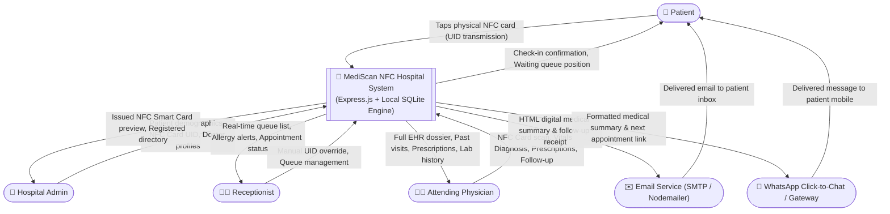
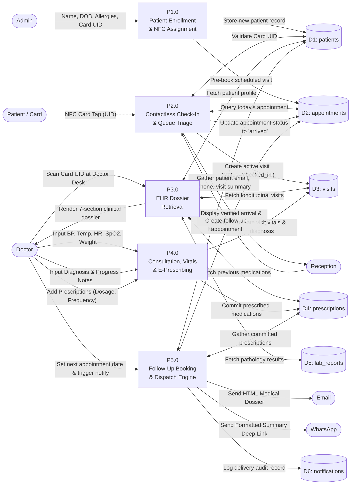
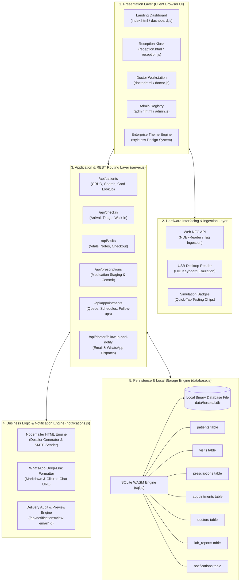
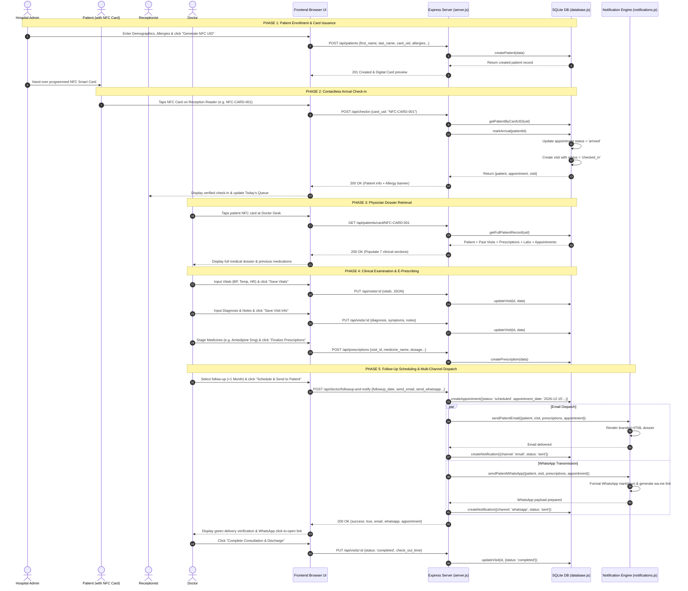
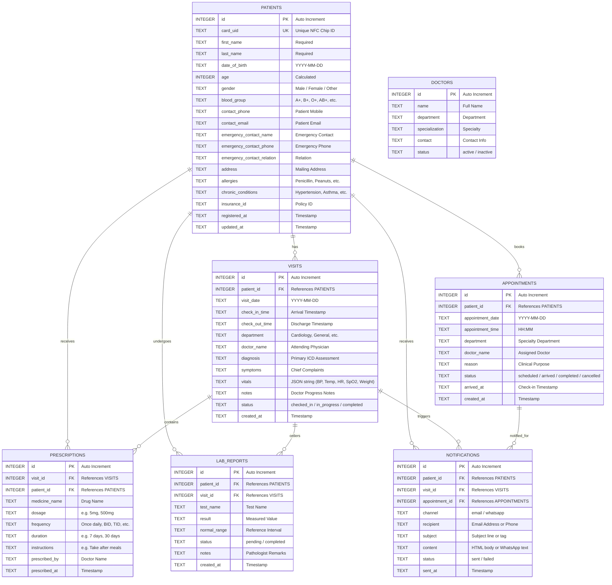

# MediScan NFC — System Architecture, Data Flow & Functional Diagrams

This document outlines the **Data Flow Diagrams (DFD Level 0 and Level 1)**, **Functional Architecture**, **Sequence of Operations**, and **Database Entity Relationships** for the MediScan NFC Hospital Patient Management System.

---

## 1. Data Flow Diagram (DFD)

### 1.1 DFD Level 0 — Context Diagram
Shows the high-level boundary of the entire system, external entities, and primary data exchanges.

---

### 1.2 DFD Level 1 — Detailed Process Data Flow
Illustrates data movement between internal processes and SQLite database tables.

---

## 2. Functional Block Diagram

Decomposes the system into its architectural layers, subsystems, and functional components:

---

## 3. End-to-End Operational Sequence Diagram

Traces a patient's complete lifecycle: registration, arrival tap, consultation, e-prescribing, and multi-channel transmission.

---

## 4. Database Entity-Relationship (ER) Diagram

Represents the relational schema within `data/hospital.db`:

---

## 5. Function & API Endpoint Mapping Reference

| Client UI Action | JavaScript Event Trigger | REST API Endpoint | Backend Function (`database.js` / `notifications.js`) | Target SQLite Table |
| :--- | :--- | :--- | :--- | :--- |
| **Register Patient** | `patientRegistrationForm.onsubmit` | `POST /api/patients` | `createPatient(data)` | `patients` |
| **NFC Card Tap (Reception)** | `handleCardScan(uid)` | `POST /api/checkin` | `getPatientByCardUID()`, `markArrival()` | `patients`, `appointments`, `visits` |
| **NFC Card Tap (Doctor)** | `loadPatientRecord(uid)` | `GET /api/patients/card/:uid` | `getFullPatientRecord(uid)` | `patients`, `visits`, `prescriptions`, `labs` |
| **Save Vitals** | `vitalsForm.onsubmit` | `PUT /api/visits/:id` | `updateVisit(id, {vitals})` | `visits` |
| **Save Diagnosis & Notes**| `currentVisitForm.onsubmit` | `PUT /api/visits/:id` | `updateVisit(id, {diagnosis, notes})` | `visits` |
| **Commit Prescription** | `btnSubmitPrescription.onclick` | `POST /api/prescriptions` | `createPrescription(data)` | `prescriptions` |
| **Schedule & Transmit** | `followupForm.onsubmit` | `POST /api/doctor/followup-and-notify` | `createAppointment()`, `sendPatientEmail()`, `sendPatientWhatsApp()`, `createNotification()` | `appointments`, `notifications` |
| **View Sent Email** | `btnPreviewEmail.onclick` | `GET /api/notifications/view-email/:id` | `getNotificationById(id)` | `notifications` |
| **Conclude Consultation** | `btnCheckoutPatient.onclick` | `PUT /api/visits/:id` | `updateVisit(id, {status: 'completed'})` | `visits` |
